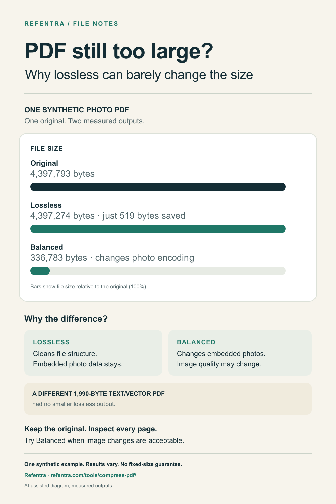

# Why a PDF can barely shrink

Lossless clean-up and image compression change different parts of a PDF. This
diagram uses one synthetic photo PDF and its actual Refentra outputs to show
why the difference matters.

## Inspect the evidence

| Version | Actual bytes | What changed in this example |
| --- | ---: | --- |
| Original | 4,397,793 | PNG-derived photograph plus selectable text and vectors |
| Lossless clean-up | 4,397,274 | File structure; the embedded photograph stream is unchanged |
| Balanced | 336,783 | Photograph encoded as JPEG at the original 1536 x 1024 pixels |

Lossless saves **519 bytes** here. The almost identical bars are intentional.
The Balanced bar is about 7.66% of the original file size. These are measurements
of one synthetic file, not an expected saving for other PDFs.

A separate 1,990-byte text/vector PDF had no smaller lossless output. An already
compact document may have little this tool can remove. Fonts, unsupported image
structures and already compressed images can also limit savings.

[Download the five original/example PDFs and exact byte/hash manifest](../pdf-compression-demo.zip)
or [read the original measurement notes](../README.md#why-a-pdf-can-stay-almost-the-same-size).
The ZIP is unchanged: SHA-256
`750617b868cbc4801ced2002e0acc118ac944f03dba24fd20628acfa7848bbdb`.
The photo in that existing ZIP is AI-generated; the diagram itself contains no
photograph or customer data.

## Choose the next step

1. Keep the original. Use a separate working copy.
2. Use lossless when preserving embedded image bytes matters. It may save little.
3. Try Balanced when changing image encoding/quality is acceptable.
4. Open the output and inspect every page, text and important image detail.

[Open Refentra's browser-local PDF compressor](https://refentra.com/tools/compress-pdf/).
It has no fixed-size target mode, rejects encrypted/digitally signed PDFs, and
offers a download only when its result is smaller. Technical preparation does
not guarantee acceptance by an upload portal.

Measurements were made on 7 October 2026 and the public ZIP/files were independently
rechecked on 11 October. This is a check of these files, not a new browser/device
test or a universal quality guarantee. The SVG [source](pdf-explainer.svg) makes
the graphic's text and proportions inspectable.

Published by Refentra's maker. Text and diagram were prepared with AI assistance;
measurements come from actual outputs and independent PDF readers. This is an
owned resource, not an independent product recommendation.
